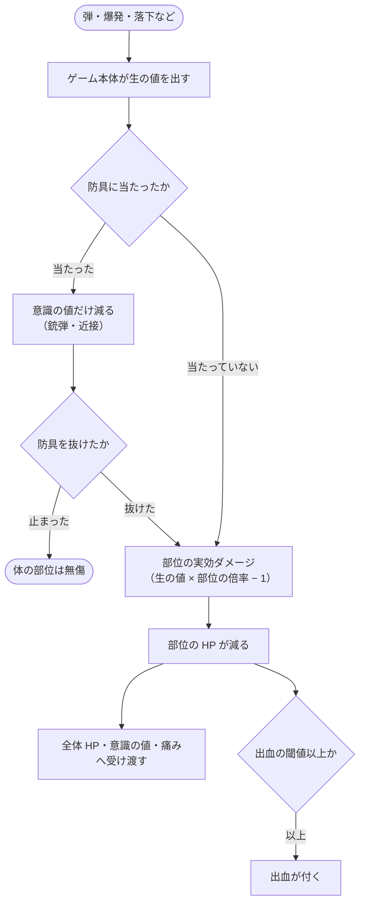

# ダメージの仕組み

> [!NOTE]
> [acemod/ACE-Anvil](https://github.com/acemod/ACE-Anvil) のソースコードとゲーム本体の処理を読んで書いた。\
> 銃弾と爆発の数値は目安で、着弾の速さや当たる位置・角度で変わる。\
> 公式ドキュメント: [ACE Anvil – Medical（Dev）](https://anvil.acemod.org/dev/components/medical/)

## 被弾から部位の HP が減るまで

ダメージは 2 段で決まる。まずゲーム本体が、弾・爆発・落下などから**生の値**を出す。次に、当たった部位がその値に**部位の倍率**を掛け、1 を引いた値だけ HP を減らす。部位の HP が減ると、全体 HP・意識の値・痛みにも受け渡され、損傷が大きければ出血が付く。

$$
\text{部位の実効ダメージ} = \text{生の値} \times \text{部位の倍率} - 1
$$

- 1 未満になったら 0（かすり傷は HP を減らさない）。
- 防具で弾が止まったときは、部位の実効ダメージは 0 で、意識の値だけが減る（[防具](#防具)）。
- 近接（銃床・銃剣）は防具の判定を通らず、体の部位に直接入る（[近接](#近接)）。
- 部位の倍率は、ダメージの種類（銃弾・近接・爆発など）ごとに部位で決まっている（ゲーム本体の値）。

| 部位 | 最大 HP | 銃弾 | 近接 | 爆発 | 出血が付く実効ダメージ |
|---|---|---|---|---|---|
| 頭 | 30 | 15 | 3 | 3 | 19.5 |
| 首 | 25 | 6 | 2 | 受けない | 16.25 |
| 胸 | 100 | 12 | 2 | 3 | 65 |
| 腹 | 100 | 7 | 2 | 1 | 40 |
| 腰 | 100 | 6 | 2 | 受けない | 40 |
| 上腕 | 70 | 8 | 2 | 受けない | 21 |
| 前腕 | 50 | 9 | 2 | 2 | 30 |
| 手 | 30 | 9 | 2 | 受けない | 24 |
| 太もも | 70 | 8 | 2 | 受けない | 52.5 |
| すね | 50 | 9 | 2 | 2 | 20 |
| 足 | 30 | 9 | 2 | 受けない | 24 |

- 破片は爆発と同じ 7 部位（頭・胸・腹・前腕・すね）だけに当たり、倍率は 1（[爆発と破片](#爆発と破片)）。
- 出血が付く値と出血の速さは [出血が始まる条件](bleeding-system.md#出血が始まる条件)、意識の値への受け渡しは [被弾で意識の値が減る量](consciousness-system.md#被弾で意識の値が減る量)。

計算例: 胸に生の値 6.77 の銃弾（5 m から撃った 5.56 M855）→ $6.77 \times 12 - 1 = 80$。胸は 100 から 20 になり、65 以上なので出血が付く。

### Hitzones を入れている場合
<!-- mods: hitzones -->

- 部位の最大 HP と倍率は変わらない。
- 全体 HP への受け渡しが 0 になり、急所（頭・胸・腹）が破壊されると Second Chance を判定する（[致命傷と Second Chance](death-second-chance.md)）。
- 手足の部位が破壊されたあとの余りは、同じ手足の中には流れるが、胴へは流れない。

## 銃弾のダメージ

銃弾の生の値は、当たったときにゲーム本体が計算する。弾の重さ・太さと、**体の中を通った長さ**で決まる。弾の設定にある「ダメージの値」は使われない。

$$
\text{生の値} = \big[\, m \times L \times (d + \text{潰れ} + \text{横転} + \text{空洞化}) \,\big]^{0.76}
$$

| 変数 | 意味 | 既定値 |
|---|---|---|
| $m$ | 弾の質量 [kg]（弾の値） | — |
| $L$ | 体の中を通った長さ [mm]（下の「体の中を通る長さ」） | — |
| $d$ | 弾の直径 [mm]（弾の値） | — |
| 潰れ | $d$ × 潰れの倍率（弾の値。5.56 M855 は 0.1） | — |
| 横転 | 横転の倍率（弾の値）× 1.5 ×（弾の長さ − $d$）× $S$ | — |
| $S$ | 体の中で失った速さ $\Delta v$ で決まる 0〜1 の値（下の式） | — |
| 空洞化 | $5 \times (v_\text{着}^2 + v_\text{抜}^2) \div (2 \times 800^2)$ | — |
| $v_\text{着}$, $v_\text{抜}$ | 着弾の速さと、体を抜けた後の速さ [m/s]。体の中で止まれば $v_\text{抜} = 0$ | — |
| 0.76 | 最後に掛かる指数（ゲーム本体の値） | 0.76 |

$$
S = 1 - 0.838 \times e^{-(\Delta v \div 442)^{1.616}}
$$

- $S$ は 0 m/s で約 0.16、200 m/s で 0.37、500 m/s で 0.76、800 m/s で 0.94。ゲーム本体の計算をこの式で近似した。
- 潰れ・横転は、体に当たった弾の直径が膨らむ分（1.5 は肉の倍率）。空洞化は、速い弾ほど大きい（薄い所を速いまま抜けても大きい）。
- **同じ弾なら、体の中を長く通るほど生の値が大きい**（胸 > 腹 > 頭 > 太もも > 前腕）。部位ごとの倍率は、その後に掛かる。

計算例: 胸に 898 m/s の 5.56 M855 → 胸を 259 mm 通って 98 m/s で抜ける（$\Delta v$ = 800）。潰れ 0.57、横転 2.43、空洞化 3.19 で、$[\,0.00402 \times 259 \times (5.7 + 0.57 + 2.43 + 3.19)\,]^{0.76} = 6.77$。胸の実効ダメージは $6.77 \times 12 - 1 = 80$ で、胸は 100 から 20 になり、65 以上なので出血が付く。

### 体の中を通る長さ

体の中では、通った長さに比例して速さが落ちる。部位の厚さより先に速さが 0 になると、弾は体の中で止まる。

$$
v_\text{抜} = v_\text{着} - L \times 0.144 \div P
$$

$$
\text{止まるまでの長さ} = v_\text{着} \times P \div 0.144
$$

| 変数 | 意味 | 既定値 |
|---|---|---|
| $L$ | 弾の通り道が部位の形（当たり判定）を横切る長さ [mm] | 下の表 |
| 0.144 | 肉の密度 1.027 × 貫通抵抗 0.14（ゲーム本体の値） | 0.144 |
| $P$ | 弾の貫通能力（$\text{貫通の深さ} \times \text{密度} \div \text{貫通の速さ}$。弾の値。5.56 M855 は 0.0466） | — |

| 部位 | 前から当たったときの長さ |
|---|---|
| 胸 | 259 mm（横からは 355 mm） |
| 腹 | 228 mm（横からは 259 mm） |
| 腰 | 254〜270 mm |
| 頭 | 180 mm（横からは 126 mm） |
| 首 | 133 mm |
| 太もも | 155〜180 mm |
| 足 | 111 mm |
| 前腕 | 98 mm |

- 手足と首は円柱に近い形で、中心から外れて当たるほど短い（太もも: 中心で 155 mm、3 cm 外れて 141 mm、6 cm 外れて 91 mm）。
- 弾が体の中で止まると、$L$ は止まるまでの長さになり、どの部位でも生の値は同じ（例: 9×19 M882 は前腕でも 95 mm で止まり、どこに当たっても生の値は 4.91）。
- 服には弾の当たり判定がなく、速さは変わらない。

### 代表的な弾

5 m から撃ったときの部位の実効ダメージ（生の値 × 倍率 − 1。括弧は生の値、「止」は体の中で止まる）。

| 弾 | 着弾の速さ | 胸（×12） | 腹（×7） | 頭（×15） | 太もも（×8） | 前腕（×9） |
|---|---|---|---|---|---|---|
| 5.56×45 M855 | 898 m/s | 80（6.77） | 42（6.15） | 76（5.16） | 36（4.61） | 29（3.28） |
| 5.45×39 7N6 | 862 m/s | 81（6.85・止） | 45（6.57） | 80（5.42） | 37（4.79） | 28（3.27） |
| 7.62×39 57-N-231 | 696 m/s | 113（9.47・止） | 65（9.47・止） | 130（8.72） | 61（7.73） | 47（5.38） |
| 7.62×51 M80 | 836 m/s | 179（14.96） | 94（13.55） | 168（11.28） | 79（10.05） | 63（7.07） |
| 7.62×54R 57-N-323S | 800 m/s | 189（15.85・止） | 101（14.64） | 180（12.05） | 84（10.65） | 65（7.30） |
| 9×19 M882 | 372 m/s | 58（4.91・止） | 33（4.91・止） | 73（4.91・止） | 38（4.91・止） | 43（4.91・止） |
| 12.7×99 M33 | 875 m/s | 795（66.34） | 417（59.74） | 739（49.30） | 349（43.73） | 274（30.51） |

- 5.56・5.45: 胸に 1 発で約 80（出血が付く）。2 発で胸が破壊される。頭は 1 発で破壊。
- 7.62×51・7.62×54R: 胸が 1 発で破壊。太もも（70）も 1 発で破壊される。
- 9 mm: 胸に約 58 で出血は付かない。2 発で胸が破壊される。頭（30）は 1 発で破壊される。
- 12.7 mm: どの部位も 1 発で破壊。
- 部位が破壊されたときに倒れるか死ぬかは、組み合わせで変わる（[致命傷と Second Chance](death-second-chance.md)）。
- Breathing を入れていると、胸への銃弾の実効ダメージが 65 以上のとき気胸を判定する（[気胸の起き方](pneumothorax-system.md#気胸の起き方)）。

### 距離による違い

距離そのものではダメージは減らない。遠くでは弾が遅くなり、遅くなった分だけ生の値が小さくなる（同じ着弾の速さなら、近くから撃っても遠くから撃っても同じ）。

弾の速さは、空気抵抗で距離とともに一定の割合で落ちる（速さの 2 乗に比例する空気抵抗）。

$$
v(x) = v_0 \times e^{-k x}
$$

$$
k = \frac{\text{空気抵抗}}{m}
$$

| 変数 | 意味 | 既定値 |
|---|---|---|
| $v(x)$ | 距離 $x$ [m] での速さ [m/s] | — |
| $v_0$ | 初速（弾の値。銃によって少し変わる） | — |
| 空気抵抗 | 弾の空気抵抗の値（弾の値） | — |
| $m$ | 弾の質量 [kg]（弾の値） | — |

- $k$ が小さい弾ほど遠くまで速さが残る。速さが半分になる距離は $0.69 \div k$。
- ゲームは空気抵抗を約 0.025 秒ごとにまとめて引くので、着弾の速さは $v(x)$ より $k \times v^2 \times 0.025$ だけ遅い（5.56 M855 の近距離で約 25 m/s）。下の表はそれを引いた値。

計算例: 5.56 M855 は $k = 0.000005 \div 0.00402 = 0.00124$。300 m での空中の速さは $930 \times e^{-0.373} = 640$ m/s、速さが半分になるのは約 560 m。

距離ごとの着弾の速さ（グラフの線は代表の 4 種）:

<!-- chart: x=距離; y=5.56×45 M855, 7.62×39 57-N-231, 7.62×51 M80, 9×19 M882; title=着弾の速さ; data=data/bullet-distance-speed.csv -->

| 距離 | 5.56×45 M855 | 5.45×39 7N6 | 7.62×39 57-N-231 | 7.62×51 M80 | 7.62×54R 57-N-323S | 9×19 M882 | 12.7×99 M33 |
|---|---|---|---|---|---|---|---|
| 0 m | 903 m/s | 867 m/s | 701 m/s | 840 m/s | 804 m/s | 374 m/s | 878 m/s |
| 100 m | 800 m/s | 774 m/s | 616 m/s | 771 m/s | 730 m/s | 321 m/s | 826 m/s |
| 200 m | 709 m/s | 690 m/s | 540 m/s | 708 m/s | 663 m/s | 275 m/s | 778 m/s |
| 300 m | 628 m/s | 616 m/s | 474 m/s | 650 m/s | 602 m/s | 236 m/s | 732 m/s |
| 400 m | 556 m/s | 549 m/s | 416 m/s | 596 m/s | 547 m/s | 202 m/s | 689 m/s |
| 600 m | 435 m/s | 436 m/s | 320 m/s | 502 m/s | 450 m/s | 149 m/s | 611 m/s |
| 800 m | 340 m/s | 347 m/s | 246 m/s | 423 m/s | 371 m/s | 109 m/s | 541 m/s |

距離ごとの胸の実効ダメージ（着弾の速さで生の値を計算し、× 12 − 1 にした値。目安の線は 65 で出血が付き、100 で胸が壊れる。12.7 mm は約 700〜800 で目盛りに収まらないので表だけ）:

<!-- chart: x=距離; y=5.56×45 M855, 7.62×39 57-N-231, 7.62×51 M80, 9×19 M882; ref=65,100; title=胸の実効ダメージ; data=data/bullet-distance-chest.csv -->

| 距離 | 5.56×45 M855 | 5.45×39 7N6 | 7.62×39 57-N-231 | 7.62×51 M80 | 7.62×54R 57-N-323S | 9×19 M882 | 12.7×99 M33 |
|---|---|---|---|---|---|---|---|
| 0 m | 80 | 82 | 113 | 179 | 190 | 58 | 796 |
| 100 m | 77 | 72 | 99 | 174 | 172 | 51 | 780 |
| 200 m | 67 | 64 | 87 | 159 | 155 | 45 | 767 |
| 300 m | 58 | 56 | 76 | 145 | 140 | 39 | 755 |
| 400 m | 51 | 50 | 67 | 133 | 127 | 35 | 744 |
| 600 m | 40 | 39 | 52 | 112 | 104 | 27 | 727 |
| 800 m | 31 | 30 | 41 | 95 | 86 | 21 | 715 |

- 胸の出血（実効ダメージ 65 以上）が 1 発目から付くのは、5.56 で約 220 m まで、5.45 で約 180 m まで、7.62×39 で約 420 m まで。7.62×51・7.62×54R・12.7 は 800 m でも付き、胸は 800 m でも 2 発で破壊される。9 mm は近くでも付かない。
- 頭（×15、30 HP）は、小銃弾なら 800 m でも 1 発で破壊される。9 mm は約 700 m まで。

### 跳弾

弾が跳ねるのは、**地面（地形）に浅い角度で当たったときだけ**。車・壁・ヘルメット・ベストでは跳ねず、抜けるか止まる（弾を止めるかどうかの計算が先に決まり、跳ねる判定まで進まない）。

- 地面では、表面に対して 1〜30° のほぼどの角度でも跳ねる。跳ねた後の速さと向きは当たった角度だけで決まり、弾の速さや種類によらない。

| 地面への角度 | 1° | 4° | 5° | 6° | 8° | 10° | 12° | 15° | 20° | 30° |
|---|---|---|---|---|---|---|---|---|---|---|
| 跳ねた後の速さ | 90% | 79% | 76% | 89% | 85% | 84% | 78% | 73% | 74% | 36% |
| 跳ねた後の上向きの角度 | 8° | 26° | 20° | 3° | 12° | 9° | 14° | 10° | 17° | 34° |

- 跳ねた弾が人に当たると、遅くなった速さの普通の銃弾として部位の HP・出血・意識の値に入る（例: 地面に 5° で当たった 7.62×51 M80 が 634 m/s で太ももに当たると、太もも（70）が破壊される）。
- 跳ねるかどうかには、弾の値（跳ねる角度の限界）も効く。小火器の弾でこの値を持つのは 9×39 の SP5・SP6 だけで、ほかは同じ既定の値。

## 防具

ベストとヘルメットは、当たり判定（防具の形）で弾を止める。止まるかどうかは、防具の材質と、弾の貫通能力・着弾の速さ・当たる角度で決まる。

$$
v_\text{着} > \frac{\text{厚さ} \times \text{密度} \times \text{貫通抵抗}}{P \times \cos\theta} \quad \text{（なら貫通する）}
$$

| 変数 | 意味 | 既定値 |
|---|---|---|
| $v_\text{着}$ | 防具への着弾の速さ [m/s] | — |
| 厚さ・密度・貫通抵抗 | 防具の材質の値（ゲーム本体の値） | — |
| $P$ | 弾の貫通能力（[銃弾のダメージ](#銃弾のダメージ)） | — |
| $\theta$ | 当たった面への入射角（垂直に当たれば 0°） | — |

止める速さの計算値（垂直に当たったとき。これより速い弾は抜ける。「止まる」は銃口の速さでも止まる組み合わせ）:

| 防具 | 5.56 M855 | 5.45 7N6 | 7.62×39 | 7.62×51 M80 | 9×19 M882 | 9×18 |
|---|---|---|---|---|---|---|
| PASGT ベスト | 339 m/s | 395 m/s | 384 m/s | 329 m/s | 止まる | 止まる |
| M69 ベスト | 160 m/s | 186 m/s | 181 m/s | 155 m/s | 203 m/s | 211 m/s |
| 6B2 ベストの前の板（胸の中央） | 363 m/s | 423 m/s | 411 m/s | 352 m/s | 止まる | 止まる |
| 6B2 ベストの縁と背中（布） | 261 m/s | 304 m/s | 296 m/s | 253 m/s | 332 m/s | 止まる |
| 6B3 ベストの前の板（胸・腹の中央） | 661 m/s | 770 m/s | 止まる | 640 m/s | 止まる | 止まる |
| 6B3 ベストの背中の板 | 363 m/s | 423 m/s | 411 m/s | 352 m/s | 止まる | 止まる |
| PASGT ヘルメット | 388 m/s | 452 m/s | 439 m/s | 376 m/s | 止まる | 止まる |
| M1 ヘルメット | 317 m/s | 369 m/s | 359 m/s | 307 m/s | 止まる | 止まる |
| DH-132 ヘルメット | 243 m/s | 283 m/s | 275 m/s | 235 m/s | 309 m/s | 止まる |
| SSh-68 ヘルメット | 202 m/s | 236 m/s | 229 m/s | 196 m/s | 257 m/s | 267 m/s |
| SPH-4・ZSh-5 ヘルメット | 89 m/s | 103 m/s | 100 m/s | 86 m/s | 113 m/s | 117 m/s |

- 6B3 の縁と脇は、6B2 の布と同じ。
- 工事用のヘルメットと戦車帽には当たり判定がなく、頭を守らない。
- 斜めに当たると、弾が防具の中を通る長さが「厚さ ÷ $\cos\theta$」になり、止める速さもその分大きくなる。
- ヘルメットは丸いので、正面から撃つと額の傾いた面に約 40° で当たり、止める速さは表の約 1.3 倍になる（横からは約 1.06 倍）。例: SSh-68 は M855 を正面からなら 269 m/s、横からなら 216 m/s まで止める。PASGT は正面 502 m/s、横 410 m/s。SSh-68 は正面からの 9×18（310 m/s）を止める。
- ベストは胸の正面・背中にほぼ垂直に当たるので、表の値に近い（6B2 の板は、7N6 を 433 m/s まで止める）。
- 抜けた弾は「着弾の速さ − 止める速さ」まで遅くなって体に当たる。例: 6B2 の板を抜けた M80（836 → 462 m/s）が胸に 103 で、胸が破壊される。
- **防具は傷まない**。同じ所に何発当たっても、同じ速さまで止める（RHS のプレートは別。下の「RHS を入れている場合」）。
- 防具・車・壁に当たった弾は、跳ねずに抜けるか止まる（[跳弾](#跳弾)）。

### 防具が覆う範囲

ベストが覆うのは胸と腹の一部で、腰（お尻・股間）・上腕は覆わない。水平に飛んでくる弾のうち、ベストに当たる割合（武器を持たずに立った姿勢）:

| ベスト | 胸（正面・真横・背中） | 腹（正面・真横・背中） |
|---|---|---|
| PASGT | 95%・82%・90% | 45%・49%・65% |
| M69 | 96%・82%・96% | 51%・53%・64% |
| 6B2 | 91%・85%・96%（板は正面 65%） | 70%・56%・35%（板は正面 65%） |
| 6B3 | 98%・83%・100%（板は正面 76%、背中 85%） | 91%・88%・95% |

- **ベストは脇の下の側面を覆っていない**。背中側から見て 45° 以上（PASGT は 30° 以上）横から胸の中心へ向かう弾は、ベストに当たらずに胸に直接入る（防具がないときと同じダメージ）。
- 首は、ベストの襟が一部を覆う（正面から 15〜60%）。
- ヘルメットが覆うのは、頭のうち正面から 15〜36%（顔が開いている）、真横から 50〜90%、後ろから 60〜100%、上からは全部。DH-132 は後ろと上だけを覆い、正面・横からは 15〜20%。
- 小銃を持っていると、正面から胸へ向かう弾の約 3 割は先に腕に、残りの 25〜40% は小銃に当たる。小銃に当たった弾は少し遅くなってから、防具や体に入る。

### 防具に当たったときの意識の値

防具に当たると、弾が止まっても抜けても、意識の値が減る（防具が受けた衝撃）。出血と部位のダメージは、弾が抜けて体に当たったときだけ。

$$
\text{意識の値の減り} = \text{防具が受けた生の値} \times \text{防具の倍率} \times 0.8 \times \text{意識の損傷の倍率}
$$

$$
\text{防具が受けた生の値} = (L_\text{防具} \times d)^{0.76}
$$

| 変数 | 意味 | 既定値 |
|---|---|---|
| $L_\text{防具}$ | 弾が防具の中を通った長さ [mm]。抜けたときは「厚さ ÷ $\cos\theta$」、止まったときは止まるまでの長さ（遅い弾ほど短い） | — |
| $d$ | 弾の直径 [mm]（弾の値） | — |
| 防具の倍率 | ベスト 0.6、ヘルメット 4（ゲーム本体の値） | — |
| 0.8 | 意識の値の基本倍率（ゲーム本体の値） | 0.8 |
| 意識の損傷の倍率 | `m_fResilienceDamageScale`（ACE の設定。防具の分にも掛かる） | 1.0 |

- 弾が抜けたときは $L_\text{防具}$ が厚さで決まるので、防具が受けた生の値は弾ごとにほぼ一定（M855・7N6 で約 15.5、M80 で約 20）。
- 斜めに当たるほど、防具の中を長く通るので大きい。
- PASGT ヘルメットのゴーグルも、ヘルメットと同じく × 4 で入る。
- 防具で止まった弾は、体の部位に入らないので、痛みも臓器の損傷も出血も起こさない。
- 防具を抜けた弾は、遅くなっていても普通の弾として部位・痛み・臓器に入る。例: 6B2 の板を抜けて約 114 m/s になった 7N6 でも、通り道にあれば心臓（Hitzones）は破壊される。

計算例:

- PASGT ヘルメットが M855 を止めた → $15.5 \times 4 \times 0.8 = 49.6$。意識の値は 100 から約 50 になる。もう 1 発止めると、意識を失う 33 を下回る。
- 6B2 ベストが 9×18 を止めた → $15.3 \times 0.6 \times 0.8 = 7.3$。意識の値は約 93 になる。

ヘルメットでは、頭に当たらなくても 1 発で気絶することがある:

- **上の方を抜けた弾は、殻に入りと出の 2 回当たり、2 回とも意識の値が減る**。PASGT を M855 が抜けると合計約 120 減り、頭は無傷のまま気絶する（SSh-68 は合計約 43）。
- 浅い角度で当たって殻の中で止まった弾も、殻の中を長く通るので大きい。PASGT の表面に約 20° で当たって止まった M855 は約 103 減り、気絶する。
- ヘルメットに当たるたびに、約 6% の確率でヘルメットが頭から外れて飛ぶ（銃弾なら防具が受けた生の値 6.4 以上。車に乗っているときは外れない）。

### 防具と爆発

- ベストは、覆っている胸への爆風と破片を止める。爆発では意識の値も減らない。正面・背中から 2 m 以上離れた手榴弾 M67 なら、胸にはほとんど何も届かない（真横からは、2 m なら破片の約 3 分の 1 が脇から入る）。
- **1 m 以内の手榴弾は、ベストの下から胸に届く**（防具がないときと同じダメージ）。地面の近くの爆発は、胸へ下から届くため。前の腹まで板で覆う 6B3 だけは、1 m 正面の破片を約 7 割止める。
- 迫撃砲弾は 3 m なら爆風を止めるが、破片の 6〜7 割は胸に入る（6 m なら届かない）。
- 地雷（足もとの爆発）には、ベストもヘルメットも効かない。
- ヘルメットが頭への爆風・破片を止めるかは、爆発の向きと距離で変わる。後ろからの爆発では止めることが多く、正面からの爆発は顔に入ることが多い。
- 頭に爆風が入ると、約 6% の確率でヘルメットが外れる。
- 防具の外の頭・腹・前腕・すねには、防具がないときと同じダメージが入る。

### RHS を入れている場合（プレート）
<!-- mods: rhs -->

RHS（RHS: Status Quo。WCS のサーバーも同じ仕組み）では、ベスト（プレートキャリア）に防弾プレートを入れて使う。**プレートだけに耐久があり**、当たるたびに減って、0 になると壊れる。ベスト本体とヘルメットは、ゲーム本体と同じく傷まない。

$$
\text{プレートの減り} = \max(0,\ \text{プレートが受けた生の値} - 4.5)
$$

$$
\text{プレートが受けた生の値} = (L \times d)^{0.76}, \quad L = \frac{v_\text{着} \times P}{\text{密度} \times \text{貫通抵抗}}
$$

| 変数 | 意味 | 既定値 |
|---|---|---|
| プレートの HP | どのプレートも同じ（RHS の値） | 52 |
| 4.5 | 1 発ごとに差し引かれる値（RHS の値）。生の値がこれ以下なら減らない | 4.5 |
| $L$ | 弾がプレートの中で止まるまでの長さ [mm]（入射角によらない） | — |
| 密度 × 貫通抵抗 | プレートの材質（鋼相当。RHS の値） | 7.86 |
| 厚さ | ESAPI 16 mm、Granit 5A 14 mm、Granit 4（側面・股）11 mm（RHS の値） | — |

止まった弾は、意識の値も減らす（本体のベストの約 3 倍）:

$$
\text{意識の値の減り} = \text{プレートが受けた生の値} \times 1.73 \times 0.8 + \text{ベスト本体が受けた生の値} \times 0.4 \times 0.8
$$

5 m から正面に当たったときの値（「気絶」は意識の値が 100 から 33 を下回る発。間に回復しないとき）:

| 弾（着弾の速さ） | ESAPI（JPC など）: 1 発の減り | 壊れる発 | 意識の値の減り / 発 | 気絶 | Granit 5A（6B45 など）: 1 発の減り | 壊れる発 | 意識の値の減り / 発 | 気絶 |
|---|---|---|---|---|---|---|---|---|
| 5.56 M855（898 m/s） | 8.9 | 6 | 19 | 4 発目 | 5.6 | 10 | 18 | 4 発目 |
| 5.56 M855A1（926 m/s） | 11.6 | 5 | 22 | 3 発目 | 8.5 | 7 | 22 | 4 発目 |
| 5.56 M995 徹甲（998 m/s） | 21.8 | 3 | 36 | 2 発目 | 18.9 | 3 | 37 | 2 発目 |
| 5.45 7N6（862 m/s） | 7.1 | 8 | 16 | 5 発目 | 3.7 | 15 | 15 | 5 発目 |
| 5.45 7N10（863 m/s） | 9.7 | 6 | 20 | 4 発目 | 6.6 | 8 | 19 | 4 発目 |
| 5.45 7N39 徹甲（827 m/s） | 22.4 | 3 | 37 | 2 発目 | 19.6 | 3 | 37 | 2 発目 |
| 7.62×39 57-N-231（696 m/s） | 8.3 | 7 | 18 | 4 発目 | 3.9 | 14 | 17 | 4 発目 |
| 7.62×51 M80（836 m/s） | 12.0 | 5 | 23 | 3 発目 | 7.9 | 7 | 22 | 3 発目 |
| 7.62×51 M61 徹甲（837 m/s） | 24.5 | 3 | 40 | 2 発目 | 21.0 | 3 | 40 | 2 発目 |
| 7.62×54R 57-N-323S（800 m/s） | 11.0 | 5 | 21 | 4 発目 | 6.7 | 8 | 21 | 4 発目 |
| 7.62×54R 7N13 徹甲（800 m/s） | 27.4 | 2 | 44 | 2 発目 | 23.9 | 3 | 45 | 2 発目 |
| 9×19 M882（372 m/s） | 3.6 | 15 | 11 | 6 発目 | 0 | 減らない | 8 | 9 発目 |
| 9×18 57-N-181S（303 m/s） | 2.3 | 23 | 9 | 8 発目 | 0 | 減らない | 5 | 13 発目 |

- 6B45 は、プレートの前にベスト本体の布（軟質アラミド 5 mm）があり、弾が遅くなってからプレートに当たるので、減りが小さい。9×18 は布で止まる。
- **プレートは、壊れるまでは小銃弾を止める**。抜けるのは 12.7 mm・14.5 mm の徹甲焼夷弾だけ。HP が減っていても、止める力は同じ。
- **プレートを壊した 1 発も止まり、次の弾から体に入る**。壊れたプレートは「Destroyed」のまま残り、直せない。新しいプレートと入れ替える。インベントリの「Plate Integrity」で残りが分かる（100% が新品）。
- **止まった弾でも気絶する**。M855 なら 4 発目、徹甲弾なら 2 発目で意識を失う。痛み・臓器の損傷・出血は起こさない。
- 斜めに当たっても、プレートの減りは同じ（止まるまでの長さが変わらないため）。
- 手榴弾の爆風・破片の受け方は、ベストで違う。6B45 は布が破片を先に受けるので、プレートは減らず、胸にもほとんど届かない。JPC は破片がプレートに直接当たってプレートが削られる（M67 の 2 m で約 22、3 m で約 10）うえ、胸には防具がないときと同じダメージが入る（プレートが小さく、胸への爆発の多くはプレートの外を通る）。焼夷ではプレートは減らない（倍率 0）。

### RHS を入れている場合（覆う範囲とヘルメット）
<!-- mods: rhs -->

プレートは胸の中央だけにある。ベストによって、プレートの外を布が覆うか（6B45 など）、何もないか（JPC など）が違う。水平に飛んでくる弾のうち、防具に当たる割合:

| ベスト | 胸（正面・真横・背中） | うちプレート（正面・真横・背中） | 腹（正面・真横・背中） |
|---|---|---|---|
| 6B45（Granit 5A） | 86%・62%・92% | 51%・12%・62% | 74%・74%・82%（プレートは正面 39%） |
| JPC（ESAPI） | 39%・15%・51% | 同じ（布がない） | 21%・9%・3% |

- JPC では、プレートを外れた弾はそのまま体に入る。6B45 では、プレートの外の布が拳銃弾を止める（小銃弾は遅くなって入る）。
- 横からは、どちらもプレートにほとんど当たらない。
- 首・腰・上腕は覆わない（6B45 の襟が首の一部を覆う）。
- RHS のヘルメットも傷まず、意識の値への倍率は × 4（ゲーム本体と同じ）。硬質アラミド 7.3 mm で、止まるのは拳銃弾だけ（小銃弾は抜ける）。WCS のヘルメット Altyn だけは倍率が × 2。
- 弾の値は RHS を入れても変わらない（[銃弾のダメージ](#銃弾のダメージ)の表のまま）。

## 爆発と破片

爆風・破片・焼夷が直接当たるのは、**頭・胸・腹・前腕・すねの 7 か所だけ**。ほかの部位は、壊れた部位の余りが流れ込むときだけ減る。

| 部位 | 爆風の倍率 | 破片の倍率 |
|---|---|---|
| 頭・胸 | 3 | 1 |
| 前腕・すね | 2 | 1 |
| 腹 | 1 | 1 |

- 実効ダメージはどちらも「生の値 × 倍率 − 1」。
- 破片の速さは、炸薬と弾殻の重さの比で決まる（M67 で約 1750 m/s）。

爆風の強さと届く距離は、炸薬の量で決まる。

$$
\text{爆風の値} = 1000 \times W^{0.64}
$$

$$
\text{爆風が届く距離} = 10\,\text{m} \times W^{1/3}
$$

| 変数 | 意味 | 既定値 |
|---|---|---|
| $W$ | 炸薬の量 [kg] × TNT に対する強さ（弾頭の値。M67 は 0.18 kg × 1.33） | — |
| 1000 | 炸薬が TNT 1 kg のときの爆風の値（ゲーム本体の値） | 1000 |
| 10 m | 炸薬が TNT 1 kg のときに爆風が届く距離（ゲーム本体の値） | 10 m |
| 0.64 | 炸薬が増えたときに爆風の値が強まる度合い（指数。ゲーム本体の値） | 0.64 |
| 1/3 | 炸薬が増えたときに届く距離が伸びる度合い（指数。ゲーム本体の値） | 1/3 |

- 指数が 1 より小さいので、炸薬が 8 倍になっても、爆風の値は約 3.8 倍、届く距離は 2 倍にしかならない。

部位が受ける爆風は、そこから距離と部位の大きさで小さくなる。

$$
\text{部位が受ける爆風} = \text{爆風の値} \times \text{減り方} \times \text{部位の見かけの大きさ}
$$

| 距離 ÷ 爆風が届く距離 | 減り方 |
|---|---|
| 0〜0.1 | 1 |
| 0.4 | 0.4 |
| 1 以上 | 0 |

- 減り方の点はゲーム本体の値。点の間のつなぎ方は、ゲームの中で計算されていて公開されていない。
- 部位の見かけの大きさは、爆発から見たその部位の形の角度の大きさで、遠いほど小さい。当たる破片の数もこれで決まり、爆発のすぐ近くでは上限で抑えられる（Bohemia の説明）。式は公開されていないので、実際の値は下の「距離ごとのダメージ」の表を見る。
- これとは別に、遮蔽物の陰でも近くにだけ届く弱い爆風がある（値 333、届く距離 3 m。手榴弾は 0.8 m）。

計算例: 手榴弾 M67（炸薬 0.18 kg、TNT の 1.33 倍）は $W = 0.24$ で、爆風の値は約 400、届く距離は約 6.2 m。2 m 離れると距離の割合は 0.32（減り方の点 0.1 と 0.4 の間）。胸が受ける爆風は 25.8 で、爆風の値の約 6%（減り方と部位の見かけの大きさの分）。

### 距離ごとのダメージ

生の値（防具なし。爆風・破片は部位ごとの合計）。

| 爆発物 | 距離 | 胸の爆風 | 胸の破片 | 頭の破片 | すねの破片 |
|---|---|---|---|---|---|
| 手榴弾 M67 | 1 m | 98.5 | 690 | 127 | 1648 |
| 手榴弾 M67 | 2 m | 25.8 | 279 | 64 | 402 |
| 手榴弾 M67 | 4 m | 3.7 | 80 | 20.5 | 93 |
| 手榴弾 M67 | 6 m | 0.05 | 35 | 9.2 | 38 |
| 手榴弾 M67 | 10 m | — | 8.5 | 2.3 | 9.3 |
| 手榴弾 M67 | 13 m | — | 1.8 | 0.5 | 2.1 |
| 手榴弾 RGD-5 | 2 m | 11.9 | 119 | 27 | 173 |
| 手榴弾 RGD-5 | 4 m | 0.9 | 33 | 8.5 | 39 |
| 手榴弾 RGD-5 | 8 m | — | 3.7 | 1.0 | 4.3 |
| 40 mm 擲弾 M406 | 1 m | 18.5 | 108 | 19 | 277 |
| 40 mm 擲弾 M406 | 4 m | — | 8.5 | 2.1 | 11 |
| 81 mm 迫撃砲弾 M821 | 5 m | 9.5 | 1264 | 329 | 1409 |
| 81 mm 迫撃砲弾 M821 | 10 m | — | 298 | 79 | 312 |
| 81 mm 迫撃砲弾 M821 | 20 m | — | 35 | 9.4 | 37 |
| 対人地雷 M14 | 0.5 m | 11.5 | — | — | 167（爆風） |

- M67 は 16 m、RGD-5 は 10 m、M821 は 30 m、対人地雷 M14 は 2 m で何も届かない。
- 2 m より遠くでは、破片が爆風よりはるかに大きい。
- 例: M67 が 4 m → 胸に破片 80 で胸は 79 減り、出血が付く。前腕とすねは破壊される。

### RPG（対戦車弾頭）

RPG-7 や M72 などの対戦車弾頭（HEAT）も、爆風・破片・焼夷は手榴弾と同じ仕組みで、7 か所に入る。違うのは次の 2 点。

- **爆風が強い**: 炸薬が PG-7VM（RPG-7）は 320 g・TNT の 1.6 倍、M72 は 303 g・1.54 倍。爆風の値は約 650・610、届く距離は約 8.0 m・7.8 m（M67 は約 400・6.2 m）。
- **弾の進む先にジェットを撃ち出す**: 爆発と同時に、質量 1 kg・直径 30 mm・約 1000 m/s の貫通体（ジェット）を弾の向きに撃ち出す。銃弾と同じ計算で、人に当たると生の値が約 900（腹なら実効約 6,300）になり、当たった部位はまず確実に破壊される。寿命は 0.1 秒で、進む先なら約 100 m 先まで届く。

破片は向きによらず全方向に飛ぶ（弾頭の向きで変わるのはジェットだけ）。PG-7VM の部位の実効ダメージ（防具なし）:

| 距離 | 胸の爆風 | 胸の破片 | すねの破片 | 弾の進む先にいたとき |
|---|---|---|---|---|
| 1 m | 約 1,100 | 約 830 | 約 950 | — |
| 2 m | 約 230 | 約 230 | 約 260 | ジェットで即死 |
| 4 m | 約 28 | 約 57 | 約 61 | ジェットで即死 |
| 6 m | 約 5 | 約 24 | 約 25 | ジェットで即死 |
| 8 m | 0 | 約 13 | 約 13 | ジェットで即死 |
| 10 m | 0 | 約 7 | 約 8 | ジェットで即死 |
| 14 m | 0 | 約 2 | 約 2 | ジェットで即死 |

- M72 もほぼ同じ値。
- 弾の進む先にいなければ、4 m 以内は爆風と破片で致命的、6 m より遠くは破片の軽傷で済む。
- RPG の弾には「SafetyDistance」（RPG-7 は 10 m）の値があり、名前からは発射からその距離までは起爆しないとみられる（説明の文字列は無い）。

### 爆発で出血するか

- 普通の爆風では出血が付かない。
- 破片と、対人地雷（M14・PMN-4）の爆風では、実効ダメージが出血の閾値以上なら出血が付く。

## 落下・衝突・車両

落下・衝突・車両のダメージは、どれも「衝突」の種類で、部位の倍率は 1（実効ダメージは値 − 1）。出血は付かない（Hitzones を入れていると、部位が壊れたときは出血する）。

### 落下

着地したときの速さで決まる。

$$
t = \frac{v - 8.85}{11.2 - 8.85}
$$

| 変数 | 意味 | 既定値 |
|---|---|---|
| $v$ | 着地したときの速さ [m/s] | — |
| 8.85 | これ以下なら無傷の速さ（ゲーム本体の値） | 8.85 m/s |
| 11.2 | $t = 1$ になる速さ（ゲーム本体の値） | 11.2 m/s |

- $t$ は 1 で頭打ちにならない（速いほど大きくなる）。
- **足から着地**: $D = 100 \times t^3$。$D$ が 50 以下なら、脚の 6 部位（太もも・すね・足）に $D \div 3$ ずつ。**$D$ が 50 を超えると、腹と腰の 2 部位だけに $D$ ずつ入り、脚には入らない**。
- **倒れた体で落ちる**（意識がない・吹き飛ばされた）: 無作為に選んだ部位の近くの 5 部位に $20 \times t$ ずつ（$t$ は 3 乗しない）。倒れた体で落ちると気絶する。

| 高さ | 着地の速さ（足から・倒れた体） | 足から着地 | 倒れた体で落ちる（5 部位） |
|---|---|---|---|
| 4 m | 8.5・8.8 m/s | 無傷 | 無傷 |
| 5 m | 9.5・9.8 m/s | 各 0.6（実効 0） | 各 7.8（実効 6.8） |
| 5.5 m | 10.1・10.3 m/s | 脚 6 部位に各 5.5（実効 4.5） | 各 12（実効 11） |
| 6 m | 10.5・10.7 m/s | 脚 6 部位に各 10.8（実効 9.8） | 各 16（実効 15） |
| 6.5 m | 11.1・11.2 m/s | 腹・腰に各 90（実効 89） | 各 20（実効 19） |
| 7 m | 11.4・11.7 m/s | 腹・腰に各 135（壊れる） | 各 24（実効 23） |
| 8 m | 12.1・12.5 m/s | 腹・腰に各 265 | 各 31（実効 30） |
| 10 m | 13.7・13.9 m/s | 腹・腰に各 900 | 各 43（実効 42） |

- 着地の速さは自由落下の速さ $v = \sqrt{2 \times 9.81 \times (h - 0.4)}$（$h$ は高さ [m]。倒れた体は $h - 0.1$）。着地の判定が、足が地面に着く少し手前で起きるので、その分を引く。
- 足から着地すると、6 m と 6.5 m の間で急に重くなる（脚 → 腹・腰）。ACE の Hitzones がないと、腹・腰の分が全体 HP に渡り（腹 0.7 倍・腰 0.65 倍）、**6.5 m 前後から死亡する**。Hitzones を入れていると全体 HP には渡らず、腹（急所）が壊れたときに Second Chance を判定する（約 6.6 m から）。
- 倒れた体の落下は、頭や首が 5 部位に入ると 6〜7 m でも死亡する。

### 水に落ちる

水面に落ちたときの縦の速さが 10 m/s 以上（高さ約 4.5 m 以上）だと、体の近くの 6 部位に等分で入る（意識は失わない）。水面での速さは、体の中心が水面に届いたときの速さで、$\sqrt{2 \times 9.81 \times (h + a)}$（$h$ は足から水面までの高さ [m]、$a$ は 0.3〜1.5 m で、高いほど大きい）。

$$
D = 0.00275 \times m^2 \times \left(0.33 \times v - \frac{1}{3.6}\right)
$$

| 変数 | 意味 | 既定値 |
|---|---|---|
| $m$ | 自分の質量 [kg] | 80 kg |
| $v$ | 水面に落ちたときの速さ [m/s] | — |
| 0.33 | 水面の倍率（ゲーム本体の値） | 0.33 |

| 高さ | 1 部位あたり | 実効 |
|---|---|---|
| 5 m | 9.6 | 8.6 |
| 10 m | 13.1 | 12.1 |
| 20 m | 18.8 | 17.8 |
| 30 m | 23.2 | 22.2 |

- 頭・首が入りやすく、ACE の Hitzones がないと全体 HP への受け渡し（頭 3.4 倍・首 3 倍）で、10 m 以上は死亡することがある。

### 車にはねられる

相手が動いていて、ぶつかる速さが 3 m/s（時速約 11 km）を超え、相手の勢い（質量 × 速さ）が 3,000 以上のときに受ける（車ならほぼ必ず満たす）。

$$
D = 0.00275 \times m^2 \times \left(v - \frac{1}{3.6}\right)
$$

| 変数 | 意味 | 既定値 |
|---|---|---|
| $m$ | 自分の質量 [kg] | 80 kg |
| $v$ | ぶつかる速さ（向き合う方向の相対速度）[m/s] | — |

- $D$ を、当たった所に近い 6 部位で等分する（80 kg なら $D = 17.6 \times v - 4.9$）。車の重さや車種は関係しない。
- **はねられると気絶する**: 当たるたびに意識の値が 33.3 に下がり、ぶつかっている間に何度も当たるので 0 になる。

| 速さ | 1 部位あたり | 実効 |
|---|---|---|
| 3 m/s（時速 11 km） | 8.0 | 7.0 |
| 5 m/s（18 km） | 13.9 | 12.9 |
| 7.5 m/s（27 km） | 21.2 | 20.2 |
| 10 m/s（36 km） | 28.5 | 27.5 |
| 15 m/s（54 km） | 43.2 | 42.2 |
| 20 m/s（72 km） | 57.9 | 56.9 |

- 頭（30）は時速約 39 km 以上で 1 回で破壊される。ACE の Hitzones がないと、頭・首が 6 部位に入れば時速 27 km 程度でも全体 HP の受け渡しで死亡する。

### 車が上から落ちてくる

車が頭より上から下向きに落ちてきて当たると、近い 6 部位に 33.3 ずつ（合計 200）。高さは関係しない。頭が入ると破壊される。このときは意識を失わせる処理はない。

### 乗っている車がぶつかる

車がぶつかったときの**車の速さの変化**（時速）で、乗員全員に同じ量 $D$ が入る。座る位置では変わらない。

$$
D = 150 \times \frac{\Delta v - 30}{80 - 30} = 3 \times (\Delta v - 30)
$$

| 変数 | 意味 | 既定値 |
|---|---|---|
| $\Delta v$ | 車の速さの変化 [km/h]（壁などに正面から当たれば、ほぼぶつかる前の速さ） | — |
| 30 | 乗員が傷つき始める速さの変化（車の値） | 30 km/h |
| 80 | $D$ が 150 になる速さの変化（車の値） | 80 km/h |
| 150 | 人が死ぬ目安のダメージ（ゲーム本体の値） | 150 |

- ヘリは 15 km/h から傷つき、120 km/h で 150（$D = 150 \times (\Delta v - 15) \div 105$）。
- 相手も動いているときは、相手との重さの比で分担が変わる（重い相手ほど自分の車の分担が増える）。
- **入り方**: 乗員ごとに、無作為に選んだ部位に $D$ の残り全部を入れ、その部位の HP を引いた残りを次の無作為の部位へ…と続ける。最初に頭や首が選ばれると、$D$ が小さくても死にうる。

| 速さの変化 | $D$ | 結果の目安 |
|---|---|---|
| 30 km/h 以下 | 0 | 無傷 |
| 40 km/h | 30 | 1 部位が少し減る |
| 50 km/h | 60 | 頭・首・手足の 1 部位が壊れうる |
| 60 km/h | 90 | 2〜3 部位が壊れる。放り出しの判定が始まる |
| 80 km/h | 150 | 多くが死亡 |
| 100 km/h | 210 | ほぼ全員が死亡 |

- **放り出しと気絶**: $D$ が 70 を超える（速さの変化 約 53 km/h 以上）と、座席ごとに 50% で選ばれ、選ばれた人は気絶させられる。ドアが開いている（ドアがない）座席なら車外に放り出される。車体が壊れたときは全員が放り出される。
- 乗り降りの途中の人には入らない。

### 車に乗っていて撃たれる・爆発に遭う

車は乗員にダメージを配らない。弾や爆発が車体を抜けて、人に直接当たるかで決まる。

- **弾**: 防具と同じ式（[防具](#防具)）で車の部品を抜け、「着弾の速さ − 止める速さ」まで遅くなって人に当たる（ダメージは遅くなった速さでの銃弾の値）。部品ごとの材質はゲーム本体のモデルで決まっている。

| 部品 | 材質（厚さ・密度・貫通抵抗） | 止める速さ（M855 / 7N6 / 9×19） |
|---|---|---|
| UAZ-469（幌）の横、M998（ドアなし）の横 | 遮るものがない | そのまま当たる |
| UAZ-469 の窓ガラス（横と前）、S1203 の横のガラス | ガラス 2 mm・2.6・1.4 | 156 / 182 / 199 m/s |
| S1203（ワゴン）のドア | 鉄板 1 mm・7.87・0.6（外板と内板の 2 枚） | 203 / 236 / 258 m/s |
| S1203 の前のガラス | 合わせガラス 4 mm・2.6・1.4 | 312 / 364 / 398 m/s（傾いているので ÷ $cos	heta$ で約 2.4 倍止める） |
| M998・M1025 の前のガラス | 防弾ガラス 15 mm・5.7・2 | 3,671 / 4,279 / 4,670 m/s（止まる） |
| M1025（装甲）のドア | 装甲 5 mm・7.86・1 | 844 / 983 / 1,073 m/s（小銃弾も止まる） |

- 例: 5 m から S1203 のドア越しに撃つと、M855 は約 900 m/s → 約 650 m/s で胸に 60 ほど、9×19 は約 370 m/s → 約 110 m/s で胸に 20 ほど。
- **爆発**: 薄い鉄板・幌・ガラスは爆風と破片を遮らない（Bohemia の説明でも、テント・トラックの幌・銃は爆発と破片を防がない）。RPG（PG-7VM）が UAZ-469・M998・M151 の横 0.3 m で爆発すると、乗員 4 人がほぼ全員死亡し、3 m でも多くが死亡する。
- 車の本体が 200 を超える爆発を受けると、座席ごとに 50% で気絶させられ、ドアが開いていれば放り出される（このときの乗員へのダメージはない）。
- 車が燃えたときは [火](#火) を見る。

### ヘリのローター

回っているローターに当たると、当たった所に最も近い 1 部位にダメージを受け、倒される。

$$
D = \frac{\text{回転数} \times 0.1}{\text{羽根の数}} \times \frac{\text{中心からの距離}}{\text{ローターの半径}} + \text{衝撃} \times 0.5
$$

- $D$ は 10〜10,000 に収められる（当たれば最低でも 10、実効 9）。出血の判定がある。
- ローターの半径と羽根の数: UH-1H は主ローター 8.5 m・2 枚、尾部 1.5 m・2 枚。Mi-8 は主ローター 12 m・5 枚、尾部 2.3 m・3 枚。回転数と衝撃はエンジンが決める。
- 止まっているローターには傷つけられない。

## その他のダメージ

### 近接

小銃の銃床や銃剣で殴られると、照準の先 1 m（武器による）の最初に当たった部位に、武器の値 × 近接の倍率（頭 3、ほか 2）− 1 が入る。出血の判定がある。

| 武器 | 値 | 届く距離 |
|---|---|---|
| 拳銃（M9・PM）、手榴弾 | 10 | 1 m |
| RPG-22、信号弾 | 15 | 1.5 m・1 m |
| 小銃（M16A2・AK-74・VZ58） | 20 | 1 m |
| 狙撃銃（M21・SVD）、機関銃（M60・PKM・RPK-74・M249）、RPG-7・M72・RPG-75 | 45 | 1〜1.5 m |
| UK59 | 50 | 1 m |
| 銃剣を付けた小銃 | 100（5 倍） | 1.6 m |

部位の実効ダメージ（「破壊」は 1 回で HP が 0、「出血」は出血が付く）:

| 値 | 頭（30） | 首（25） | 胸（100） | 腹（100） | 太もも（70） | すね（50） |
|---|---|---|---|---|---|---|
| 10 | 29（出血） | 19（出血） | 19 | 19 | 19 | 19 |
| 20 | 59（破壊） | 39（破壊） | 39 | 39 | 39 | 39（出血） |
| 45 | 134（破壊） | 89（破壊） | 89（出血） | 89（出血） | 89（破壊） | 89（破壊） |
| 100 | 299（破壊） | 199（破壊） | 199（破壊） | 199（破壊） | 199（破壊） | 199（破壊） |

- **銃床でも頭や首に当たれば 1 回で破壊される**。ACE の Hitzones がないと、そのまま死亡する。
- 腹・腰は 39 では出血しない（閾値 40）。
- **近接は防具を素通りする**。ベストやヘルメットを着ていても、殴られた部位にそのまま入る（ベストの下の胸、ヘルメットの下の頭にも）。

### 発射機の後方（backblast）

発射機を撃つと、後ろにいる人にゲーム本体と ACE の両方のダメージが入る。

**ゲーム本体**: 後方の円錐の中で、中心線に最も近い 1 部位（後ろに立っていると頭）に入る。障害物の陰には入らない。

$$
\text{ダメージ} = \text{基準値} \times f_\text{距離}\!\left(\frac{\ell}{L}\right) \times f_\text{角度}(\cos\theta)
$$

| 変数 | 意味 | 既定値 |
|---|---|---|
| 基準値 | 発射機ごとの値（ゲーム本体の値） | 下の表 |
| $\ell$ | 発射機の後端からの距離 [m] | — |
| $L$ | 後方の長さ（発射機ごとの値） | 下の表 |
| $\theta$ | 後方の中心線からの角度（円錐の半角まで） | — |
| $f_\text{距離}$ | 点 (0, 1)・(0.327, 0.976)・(0.664, 0.264)・(1, 0) を通る曲線（ゲーム本体の値） | — |
| $f_\text{角度}$ | 点 (0, 0)・(0.203, 0.181)・(0.512, 0.952)・(1, 1) を通る曲線（ゲーム本体の値） | — |

曲線は、隣り合う点 $(x_i, y_i)$ と $(x_{i+1}, y_{i+1})$ の間を次の 3 次式でつなぐ（一様な Catmull-Rom）。

$$
s = \frac{x - x_i}{x_{i+1} - x_i}
$$

$$
y = (2s^3 - 3s^2 + 1)\,y_i + (s^3 - 2s^2 + s)\,m_i + (-2s^3 + 3s^2)\,y_{i+1} + (s^3 - s^2)\,m_{i+1}
$$

- 傾き $m_k$ は、途中の点では $(y_{k+1} - y_{k-1}) \div 2$、両端の点では隣の点との差。点と点の間で少し膨らむので、距離の倍率は 1 を少し超えるところがある。

| $\ell \div L$ | 0 | 0.1 | 0.2 | 0.3 | 0.4 | 0.5 | 0.6 | 0.7 | 0.8 | 0.9 | 1 |
|---|---|---|---|---|---|---|---|---|---|---|---|
| $f_\text{距離}$ | 1 | 1.015 | 1.035 | 1.002 | 0.859 | 0.624 | 0.381 | 0.217 | 0.125 | 0.065 | 0 |

- 円錐の中では $f_\text{角度}$ は 0.998〜1.002 で、ほぼ 1。ダメージは距離だけで決まる。

| 発射機 | 基準値 | 後方の長さ | 円錐の半角 | 1 m | 2 m | 頭が壊れる距離 |
|---|---|---|---|---|---|---|
| RPG-7 | 224 | 3.36 m | 22.5° | 225 | 88 | 2.6 m まで |
| RPG-22 | 196.84 | 2.95 m | 18° | 189 | 48 | 2.2 m まで |
| RPG-75 | 154.98 | 2.32 m | 20° | 123 | 13 | 1.7 m まで |
| M72 | 148.5 | 2.23 m | 25° | 112 | 10 | 1.6 m まで |

- 衝突の種類なので、部位の実効ダメージは値 − 1。出血は付かない。
- **脳震盪**: 同じ式で、基準値 3、距離の点 (0, 1)・(0.305, 0.958)・(0.569, 0.255)・(1, 0)、角度の点 (0, 0)・(0.335, 0.673)・(0.526, 0.926)・(1, 1)。この値の 8.5 倍が意識の値に直接入る（最大で約 26）。
- 迫撃砲も、発射の瞬間に近くの人の意識の値を減らす（脳震盪だけ）。

**ACE**: 後方 15 m までの扇（中心線から 45° まで）の中の全員の**全部位**に、爆発の種類で入る。射手本人と、障害物の陰の人には入らない。

$$
a = 1 - \frac{\theta}{45°}, \quad R = 10 + 5 \times a, \quad d = 25 \times \left(1 - \frac{\ell}{R}\right) \times a
$$

| 変数 | 意味 | 既定値 |
|---|---|---|
| $\theta$ | 後方の中心線からの角度 | — |
| $\ell$ | 発射機の後端からの距離 [m] | — |
| $R$ | 届く距離（中心線で 15 m、45° で 10 m） | — |
| 25 | 最大のダメージ（ACE の値） | 25 |

- 部位の実効ダメージは $d$ × 爆風の倍率（頭・胸 3、前腕・すね 2、ほか 1）− 1。
- 部位ごとに $2d \div 25$ の確率で出血が付く（$d$ が 12.5 以上なら必ず）。

| 中心線上の距離 | $d$ | 頭・胸 | 前腕・すね | ほかの部位 | 出血の確率 |
|---|---|---|---|---|---|
| 1 m | 23.3 | 69（頭は破壊） | 46 | 22 | 100% |
| 5 m | 16.7 | 49（頭は破壊） | 32 | 16 | 100% |
| 8 m | 11.7 | 34（頭は破壊） | 22 | 11 | 93% |
| 10 m | 8.3 | 24 | 16 | 7 | 67% |
| 14 m | 1.7 | 4 | 2 | 0 | 13% |

- **中心線上なら後方約 8.8 m まで頭が破壊される**。真後ろ 10 m 以内に人を立たせない。

### 火

人は燃えない。ダメージを受けるのは、燃えている車に乗っているか、そのすぐ近くにいるとき。

- **乗員**: 1 秒ごとに $8 \times (\text{火の強さ} \div 最弱の火の強さ)$（最弱 8・最強 32。ヘリは 4〜16）が、無作為の部位に入る（乗っている車がぶつかるときと同じ入り方）。
- **燃えている車の周り**: 1 秒ごとに火の範囲のダメージ（火・焼夷）が出る。乗員は最弱の火でも 1〜2 秒で死亡する。すぐ横（1 m）の人は少しずつ減ることがあり（25 秒で全体 HP が約 4 割減る）、3 m 以上離れれば受けない。
- **燃え尽き**: 車体は 40〜160 秒（火の強さによる）で壊れ、爆発する。M151（機関銃付き）では 2 m 以内が死亡、5 m で重傷、10 m で軽傷。
- 焼夷弾・曳光弾の焼夷の分は値が小さく（0.75〜3）、ほとんど効かない。
- 出血は付かない。

### ACE の弾薬誘爆

ACE を入れていると、燃えている車に積んだ弾薬が誘爆する。

- 燃え始めてから 5〜11 秒後に始まり、0〜10 秒 ÷ √（残りの弾数）の間隔でくり返す。
- 弾倉なら 1 回に 1〜5 発が減り、80% の確率で 1 発を、初速の 0.1〜2.5% で無作為の向きに撃ち出す。弾はとても遅いので、当たってもほとんど効かない。
- 爆発物（手榴弾・ロケットなど）は、50% で消え、50% でその爆発物として爆発する。
- 車体が燃え尽きて壊れたときの爆発は [火](#火) と同じ。

### 有刺鉄線

鉄線の中を動いていると、ダメージが少しずつ溜まり、溜まるたびに近くの部位（鉄線の中心に近い 3 部位から無作為の 1 つ）を切られる。

- 1 回の値は**その部位の最大 HP の 10%**（近接の種類なので × 2、頭は × 3）− 1。胸・腹・腰 19、上腕・太もも 13、前腕・すね 9、頭 8、手・足 5、首 4。
- 1 回ごとに **60%** で出血が付く（設定の説明は 40% だが、ゲーム本体の処理は逆になっている）。
- 溜まる速さは動く速さで変わり、ゆっくりなら約 1 秒に 1 回、速いほど増える（最大で毎秒 5 回）。鉄線の中では動ける速さが 2 割に落ちる。止まっていれば受けない。

### 素足

靴を履いていないと、動いている間（伏せ・泳ぎを除く）に足の HP が少しずつ減る。

- 45〜94 秒ごと（速く走ると 10 倍の速さで溜まり、約 7 秒ごと）に、足に $(足の HP - 20) \times 0.3$（最低 1）が近接の種類で入る（実効は 2 倍 − 1）。右足から減り、20 まで減ると左足に移る。両足とも 19 で止まる。
- そのたびに 15%（両足とも減りきると 30%）で転び、5 秒倒れる（傾いた地面のとき）。
- 歩く速さの上限が 0.8 倍になる。出血は付かない。

### 溺水

頭が水面より下にある時間を数え、**45 秒**を超えると、意識があれば意識の値に、意識がなければ頭に、毎フレーム 1000 が入る（倍率は掛からない）。意識を失い、次の瞬間に頭が壊れて死亡する。

- 頭が水面に出ると、数えた時間は 0 に戻る。
- 水に強い座席（乗ったまま沈んでも溺れない車）では数えない。
- ACE の意識の損傷の倍率を小さくしても、1000 が大きいのですぐ意識を失う。

### 毒

毒の範囲に触れていると、部位に毎秒のダメージ（DPS）が入り、触れている間は約 7 秒で 2 倍のペースで増える（上限は毎秒 100）。離れると約 7 秒で半分のペースで減る。毒がある間は自然回復が止まる。ゲーム本体のマップには毒の範囲はない（MOD やシナリオで置かれる）。

## ダメージの種類の一覧

| 種類 | 主な元 | 部位の倍率 | 防具 | 出血の判定 |
|---|---|---|---|---|
| 銃弾 | 銃弾、RPG のジェット | 頭 15、胸 12、腹 7、腰・首 6、上腕・太もも 8、そのほか 9 | 止まれば部位は無傷（意識の値は減る） | あり |
| 近接 | 銃床・銃剣、有刺鉄線、素足 | 頭 3、そのほか 2 | 素通り（防具の下の部位に入る） | あり（有刺鉄線は 60%、素足はなし） |
| 爆風 | 爆発物、ACE の backblast | 頭・胸 3、前腕・すね 2、腹 1。ほかの部位は受けない（ACE の backblast だけは全部位に入り、7 か所以外は倍率 1） | 2 m 以上ならベストが胸を守る（1 m 以内は下から、真横からは脇から一部が届く）。ヘルメットは向きと距離による | なし（対人地雷はあり。ACE の backblast は独自の確率） |
| 破片 | 手榴弾・砲弾・RPG | 爆風と同じ 7 部位に 1 | 爆風と同じ（迫撃砲の近くでは多くが通る） | あり |
| 衝突 | 落下、水面、はねられる、乗っている車の衝突、本体の backblast、ローター | 1 | — | なし（ローターはあり） |
| 火・焼夷 | 燃えている車、焼夷弾 | 1 | — | なし |
| 倍率なし | 溺水、本体の backblast の脳震盪 | 掛からない | — | なし |

## 関連ページ

- [出血の仕組み](bleeding-system.md)
- [意識の仕組み](consciousness-system.md)
- [致命傷と Second Chance](death-second-chance.md)
- [痛みの仕組み](pain-system.md)
- [気胸の仕組み](pneumothorax-system.md)
- [出血と止血](hemorrhage.md)

## 出典

- [Arma Reforger: Weapon Creation/Prefab Configuration](https://community.bistudio.com/wiki/Arma_Reforger:Weapon_Creation/Prefab_Configuration)（Bohemia Interactive Community Wiki。貫通の計算と材質。2026-10-17 確認）
- [Arma Reforger: Character Gear Creation/Vest/Prefab Configuration](https://community.bistudio.com/wiki/Arma_Reforger:Character_Gear_Creation/Vest/Prefab_Configuration)（防具の仕組み。2026-10-17 確認）
- [Arma Reforger: Damage System](https://community.bistudio.com/wiki/Arma_Reforger:Damage_System)（ダメージの流れ。2026-10-17 確認）
- [Explosive Damage Rework and Explosive Changes for 1.2.1](https://reforger.armaplatform.com/news/modding-update-sept-10-2024)（Arma Reforger 公式ニュース、2024-09-10。爆風の強さと距離。2026-10-17 確認）
- [1.2.1.169 Update](https://reforger.armaplatform.com/news/update-december-12-2024)（公式ニュース、2024-12-12。銃弾の終末弾道。2026-10-17 確認）
- [1.3.0.130 Changelog](https://reforger.armaplatform.com/news/changelog-march-27-2025)（公式ニュース、2025-03-27。防具が当たり判定で守る方式。2026-10-17 確認）
- [RHS - Status Quo](https://reforger.armaplatform.com/workshop/595F2BF2F44836FB-RHS-StatusQuo)（Red Hammer Studios、Arma Reforger Workshop。0.16.5237 の設定とスクリプトを読んで書いた。プレートの耐久・意識の値の倍率・プレートの材質。RHS の作者の確認は受けていない。2026-10-20 確認）
- [RHS: Status Quo – PC Gen III](https://docs.rhsmods.org/rhs-status-quo-user-documentation/arma-reforger/rhs-status-quo/blufor/uniforms/vests/pc-gen-iii)（RHS の公式ドキュメント。プレートの劣化と表示。2026-10-20 確認）
